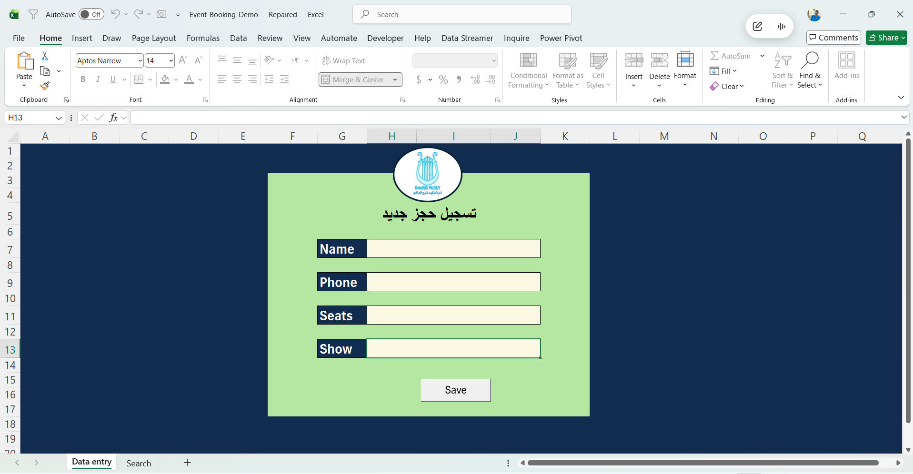
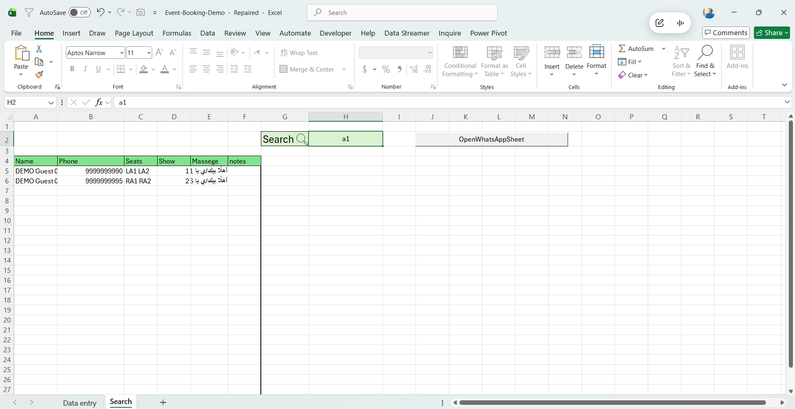

# Event Booking Management System | Excel & VBA

**Excel · VBA · Booking Operations · Process Automation**

A practical booking management tool I built to help organize reservations for community theatre performances. The project started as an Excel-based seat management workflow and evolved into a VBA-enabled workbook for entering, storing, and finding bookings.

> **Demo version:** The workbook in this repository contains fictional guest details instead of real attendee records. It is intended to demonstrate the workflow, not to process actual customer bookings.

## The problem

Handling event reservations manually can make it difficult to keep booking information organized, find a reservation quickly, and prepare confirmation messages. I wanted a simple system that could support the team's day-to-day booking process using the tools already available to us.

## My solution

- **Booking form:** Enter guest name, phone number, seat numbers, and show number in one place.
- **Save action:** Use an Excel VBA macro to validate required fields and add a booking to a structured table.
- **Booking search:** Find saved records using the workbook's search sheet.
- **WhatsApp support:** Prepare a booking-confirmation link and let the operator open it to send a message **manually**. The system does not automatically send WhatsApp messages.
- **Two-show workflow:** The example workbook handles bookings for two performances.

## Screenshots

### Booking registration

### Find an existing booking

## Technologies

| Tool | Use |
| --- | --- |
| Microsoft Excel | Booking entry, tabular storage, and search interface |
| VBA | Form validation, saving new records, and opening confirmation links |
| Excel tables and formulas | Organizing booking records and supporting search/confirmation workflows |
| WhatsApp links | Operator-assisted booking confirmations |

## Try the demo

1. Download [`Event-Booking-Demo.xlsm`](demo/Event-Booking-Demo.xlsm).
2. Open it with **Microsoft Excel for Windows (desktop)**. Review the VBA before enabling macros; only enable them if you trust the workbook.
3. On the **Data entry** sheet, use fictional details to create a booking, then press **Save**.
4. Open the **Search** sheet and try finding a demo booking.
5. Do not send WhatsApp messages from the demo; its phone numbers are placeholders.

*Note: VBA macros are not supported in Excel Online. This is a demonstration workbook; worksheet protection is not a security boundary.*

## Project development

| Stage | What changed |
| --- | --- |
| **V1 — Seat management** | An earlier Excel workbook to organize seats for a theatre event. |
| **V2 — Booking workflow** | Added a booking form, VBA automation, search, and manual WhatsApp confirmation links. |
| **Next — Web-based management** | A separate web version is being developed. It is not part of this Excel/VBA release. |

## What I learned

This project helped me translate a real operational problem into a practical workflow, think through user input and booking records, and use Excel/VBA to reduce repetitive manual steps.

## Privacy and scope

- The public demo uses fictional guests and placeholder phone numbers.
- Original event booking records and attendee contact information are **not** included.
- The original event video is **not** included because it shows real booking details.
- This is an operational Excel/VBA project, not a production-grade reservation platform or a secure ticket-payment system.

---

**Created by [Peter Nabil](https://github.com/Peternab8)** · [LinkedIn](https://www.linkedin.com/in/peter-nabilg/)
